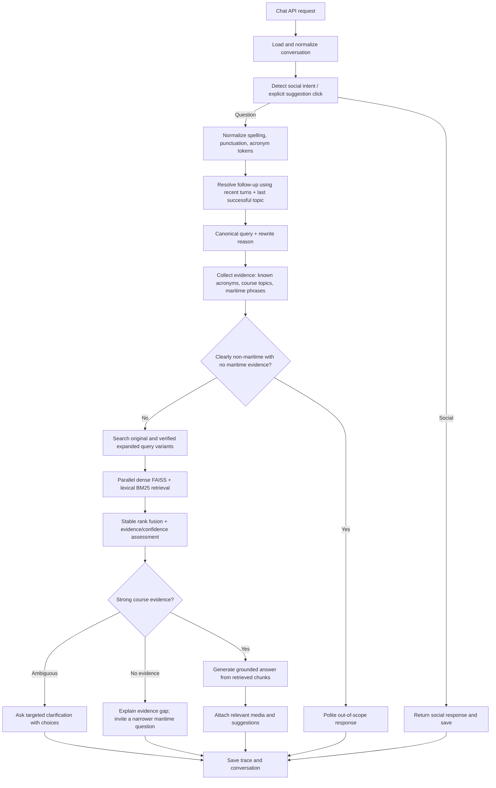

# Query routing and retrieval review

Date: 2026-10-22
Scope: Static code review of the active chat request path, acronym recognition, off-topic decisions, and course retrieval. No application code or tests were changed/run for this review.

## Executive summary

The request flow is implemented in several overlapping places. The active API handler calls `ChatService.run_chat`, but a graph/pipeline implementation also contains routing, retrieval, and off-topic logic. Some graph nodes reuse chunks already retrieved by `ChatService`; other paths have their own rewrite and retrieval steps. This makes behavior hard to reason about and means a fix in one path may not fix the path used for a particular request.

The reported symptoms are consistent with these code-level risks:

1. **Long / variable response time:** `run_chat` tries just-in-time acronym discovery before its fast path. It can call the LLM once per candidate token, with no explicit timeout around that call. Only after this does it decide whether it can route directly. For non-fast-path queries, rewrite and intent classification run concurrently, but classification is performed on the original query while rewrite is a separate result. Later stages then call additional LLMs for answer generation and sometimes off-topic responses/query expansion.
2. **Repeated or contextually related questions can drift:** `rewrite_query` decides whether a short query is a follow-up partly by searching whether the query text appears anywhere in the last assistant answer. It uses the most recent user question as its context anchor, not necessarily the last successfully answered topic. The analyzer has another rewrite implementation with simpler rules. Both raw and rewritten text are subsequently considered by off-topic gates.
3. **Acronyms can still be sent off-topic:** dynamic resolution only recognizes what is already harvested or successfully resolved. JIT failures/latency, token extraction edge cases, ambiguity exclusions, and inconsistent acronym checks across components leave gaps. The hard off-topic expression runs before the general acronym/domain exemption in `is_off_topic_query`; later gates also independently inspect raw and rewritten queries.
4. **FAISS is not the whole retrieval system:** `VectorStoreAdapter` combines FAISS and BM25 using reciprocal-rank fusion. Acronym expansion happens in a retrieval adapter, but other routes use their own query expansion/filtering. A good FAISS match can be filtered later, or a dynamically learned acronym may not be expanded consistently in every route.
5. **Prior green scenario reports do not prove current production behavior:** the repository has scenario result documents and scratch traces, but they are snapshots of selected scenarios. They do not establish that all cases were run against the current working tree, live stores, live model behavior, or the same active path.

## What calls what (current active path)

`backend/api/chat_router.py` calls `ChatService.run_chat`. The relevant main stages are in `backend/services/chat_service.py`:

1. Clean saved conversation messages; collect previous user questions and last assistant answer.
2. Detect whether a short term appeared in the last answer or matches a suggestion/link; resolve any pending clarification reply.
3. Correct typos against course topic names.
4. Fast-route social messages.
5. For non-social queries, try dynamic acronym resolution for candidate tokens.
6. Decide whether the query qualifies for direct marine routing. This depends on acronym/domain signals, hard off-topic filtering, follow-up/coreference indicators, and query shape.
7. Otherwise, concurrently call `rewrite_query(...)` and `analyzer.classify_for_router(current_query, previous_questions)`. The classifier gets the raw `current_query`, not the result of the rewrite task.
8. Fetch chunks through `_retrieve_chunks(...)`. The adapter runs FAISS dense search and BM25 lexical search, then merges results with RRF. A relevance filter and acronym-conflict filter can remove chunks.
9. Check clarification and off-topic conditions, call the answer pipeline, add media/suggestions, and save history.

There is also a second family of modules (`backend/graph/*` and `backend/pipeline/*`) with separate router/retrieval/query code. `backend/graph/retrieval_node.py` explicitly reuses pre-fetched `ChatService` chunks in some states. That is useful, but it also means routing and safety logic is distributed across both paths and must be mapped before changing shared behavior.

## Main issues and recommended changes

| Priority | Code area | Current behavior / risk | Recommended change | Why |
|---|---|---|---|---|
| P0 | `services/chat_service.py` acronym pre-routing block; `services/dynamic_acronym_service.py` | Calls JIT LLM resolution for unknown uppercase/alphanumeric tokens before routing. No explicit request timeout is set around the model call. Several candidate tokens can mean several serial waits. | Make acronym resolution bounded and non-blocking for routing: impose a strict timeout/budget, resolve only high-confidence candidates, and continue with the original query if unresolved. Cache positive and negative outcomes; add observable reason codes. | Prevent acronym discovery from delaying every response or blocking routing when the acronym service/model is slow. |
| P0 | `services/chat_service.py` rewrite/classify block; `services/query_analyzer.py` | Separate rewrite and classify logic; classifier sees raw query while retrieval sees rewritten query. The analyzer has its own standalone-query logic. | Establish a single canonical `QueryAnalysis` result: raw text, resolved standalone query, intent, domain evidence, acronym evidence, and confidence. Classify the canonical query (and preserve raw text for safety checks) in one explicit sequence. | Prevent contradictory routing/search interpretations and simplify debugging. |
| P0 | `services/off_topic_detector.py`; off-topic gates in `chat_service.py`, `query_analyzer.py`, `pipeline/query.py` | A hard keyword/pattern match may win before general marine/acronym exemptions. Several gates reject if either the raw or standalone query matches. Keyword filters can fire on quoted examples or mixed-domain questions. | Replace binary substring-style decisions with an evidence-based decision order: explicit maritime context / known course topic / known acronym first; hard off-topic only when no maritime evidence; mixed-domain questions go to clarification or in-scope handling. Make raw-vs-rewritten policy consistent. | Reduce false off-topic answers without allowing obviously unrelated questions through. |
| P1 | `services/chat_service.py` `rewrite_query`; history selection | A short phrase occurring in the last assistant answer can trigger rewriting even when the user has switched topics. Rewrite anchor is the latest user question, not a stored last-successful topic. | Rewrite only when there is a real reference/follow-up cue or a structured suggestion/clarification click. Provide a compact recent-turn context with the last successful topic and its answer; keep independent queries unchanged. | Avoid old-topic contamination and repeat-question drift. |
| P1 | `services/dynamic_acronym_service.py`; acronym registry / `off_topic_detector.py` | Runtime learning depends on DB harvest or JIT. Harvester pattern coverage is title-oriented; generated expansion can be bad or ambiguous. The in-memory map/negative cache can differ by process/startup state. | Treat acronym candidates as evidence rather than truth. Normalize/extract consistently; validate a learned expansion against course topics/chunks before promoting it; track source, timestamp, confidence, and ambiguity. Ensure all workers load the same persisted registry. | Improve coverage while avoiding false-positive acronym overrides and replica inconsistency. |
| P1 | `services/chat_service.py` `_retrieve_chunks`, `retrieval/bm25_store.py`, `retrieval/faiss_store.py` | Dense and lexical retrieval are fused, but a single expanded query/filter path can miss acronyms or rank noisy chunks. Later relevance/conflict filters may remove all useful results. | Search variants in parallel: original query, normalized acronym + verified expansion, and (for follow-ups) resolved standalone query. Fuse by document identity, preserve source scores, and keep a transparent fallback/low-confidence state. | Exact acronym matches benefit from BM25; semantic context benefits from FAISS. Separate variants reduce the risk that expansion dilutes exact tokens. |
| P1 | `services/chat_service.py` and graph/pipeline modules | The same policy is implemented in multiple paths. Fixes and logging can differ. | Make `ChatService` the sole owner of query analysis/routing/retrieval decisions, or clearly define graph components as the only implementation and route the API through it. Keep compatibility wrappers thin. | One workflow means behavior and tests are reproducible. |
| P2 | logging / API response diagnostics | Current logs are extensive but decisions are mostly inferred across stages; users see generic off-topic or weak retrieval outcomes. | Emit one structured trace per request: chosen route, rewrite reason, acronym candidates/resolution source, off-topic evidence, retrieval sources/scores, filters applied, timings, and final answer mode. Do not expose internals to end users by default. | Makes a bad answer diagnosable from one trace instead of guesswork. |

### Important design rule for topic decisions

Acronym detection should not automatically force an answer. It should prevent a premature off-topic rejection, then the system should search the course corpus. If the corpus has strong evidence, answer from it. If retrieval is weak, ask a short clarifying question or state that the course material did not contain enough detail. This protects both recall and answer grounding.

## Concrete failure scenarios to account for

These are failure modes inferred from current control flow; they are not claims that every case was reproduced live.

| Scenario | Why current code can fail | Desired behavior |
|---|---|---|
| A question contains several uppercase unknown tokens (e.g. acronym plus vessel/model code) | The JIT resolver loops candidates before routing; each may wait on an LLM call. | One bounded resolution budget; continue to retrieval even if resolution times out. |
| A known but newly introduced course acronym is not in the DB harvest or this worker's memory | `is_known_acronym` returns false; JIT can fail, be rejected, or be skipped due to candidate rules. | Unknown acronym should reach lexical retrieval and/or a single clarification path, never immediate off-topic solely for being unknown. |
| User asks a maritime question containing a hard off-topic phrase as an example/contrast | Hard regex runs before general marine/acronym exemption; regex is not intent-aware. | Preserve clear maritime intent and treat the non-marine phrase as context. |
| User switches topics to a short term also mentioned in the previous answer | Literal match to last assistant answer can trigger contextual rewrite; previous question may be unrelated. | Keep as standalone unless it has a genuine referential cue or matches a specific suggestion. |
| Follow-up is “what about MSA?” after a detailed prior answer | Rewrite and classification may diverge because classification sees raw text; “MSA” may have multiple meanings. | Resolve using recent topic plus acronym candidates; ask what MSA means only when context/corpus cannot disambiguate. |
| Typo is in an acronym or several terms (“SECP”, “boilr radarr”) | Topic-name fuzzy correction is applied at particular points; not every token or path gets identical correction. | Apply one normalized typo pass before domain classification and preserve original token for BM25. |
| Unknown dynamic acronym exists only in document body, not topic title | Startup harvester scans `topic_name`; JIT model judgment may be inaccurate. | Search exact token across BM25 corpus before deciding it is unknown/off-topic; allow evidence-backed discovery. |
| Acronym has multiple maritime expansions or is also an everyday word | Single global expansion or ambiguity list can select wrong meaning; short-query routing can over-trust a match. | Use context and candidate course results to disambiguate; offer choices for truly ambiguous bare acronyms. |
| `is_off_topic_query(raw)` is true while rewritten standalone is clearly maritime (or vice versa) | OR-based guards can block a valid query because one representation has a false positive. | Use a shared policy that records evidence for both forms and decides on the canonical, context-resolved request. |
| Course has the correct material but FAISS ranks a nearby acronym topic first | Fused ranking, expansion, and conflict filters can alter/remove results after search. | Log and inspect dense/BM25 ranks; search acronym variants and calibrate retrieval confidence before response. |
| Retrieval returns empty/low-confidence chunks for an in-scope question | Off-topic and low-relevance behavior can become indistinguishable to the user. | Say “I couldn’t find enough in the course material” or ask a targeted clarification; don’t label it off-topic. |
| User repeats the exact same question after a delay or after a different exchange | No explicit intent to repeat; the rewrite heuristic can attach prior context and classification may vary. | Treat exact repeats as independent requests by default, optionally reuse retrieval cache keyed by normalized query. |
| Query asks two maritime questions plus one unrelated subquestion | Hard off-topic terms or whole-query classifier can reject/answer everything as one topic. | Split or answer the in-scope maritime part and clearly identify the excluded part. |
| Redis/cache unavailable or app has multiple workers | Dynamic acronym memory is process-local; the cache path may vary by worker. | DB/corpus evidence remains authoritative; dynamic learning failure degrades to search/clarification, not refusal. |
| Query is a valid new maritime term longer than current token extraction assumptions | Token regex, uppercase rules, hyphen stripping, or length bounds can miss it. | Shared tokenizer with tests for punctuation, slash/hyphen, digits, Unicode, and 2–12+ character codes. |

## Proposed implementation plan

### Phase 1 — Make decisions inspectable

- Add a typed query-analysis record and a single structured decision trace.
- Record raw query, canonical standalone query, rewrite reason, intent, maritime evidence, acronym evidence/source, off-topic evidence, and stage timings.
- Distinguish `OFF_TOPIC`, `IN_SCOPE_LOW_EVIDENCE`, `AMBIGUOUS`, and `IN_SCOPE_ANSWERABLE` outcomes.

### Phase 2 — Unify rewrite and routing

- Resolve references using a bounded recent-turn context and the last successful topic, not only the last user utterance or string membership in an answer.
- Classify the canonical query and preserve the raw query only as supporting evidence.
- Ensure the final decision and retrieval query are the same canonical request.

### Phase 3 — Bound and verify acronym resolution

- Apply consistent tokenization and candidate rules.
- Search known registry and BM25 exact token before an external JIT call.
- Limit JIT calls/time per request, cache outcome, and do not let failure stop the request.
- Validate candidate expansions against course topics/chunks and retain multiple senses when evidence supports them.

### Phase 4 — Make off-topic decisions evidence-based

- Check strong maritime context, verified course topics, and known acronyms before hard off-topic patterns.
- Handle mixed-domain and quoted-example questions separately.
- Use one shared decision function in the active path and graph compatibility path.
- Treat weak retrieval as an evidence gap, not an off-topic result.

### Phase 5 — Improve hybrid retrieval and answer confidence

- Retrieve original query + verified acronym expansions as separate variants.
- Fuse FAISS and BM25 rankings with stable document IDs and retain per-source scores.
- Calibrate thresholds against labeled examples; avoid silent deletion of every result without a clear low-confidence outcome.
- Ground the response in retrieved chunks; ask a targeted clarification when ambiguity remains.

### Phase 6 — Consolidate the workflow

- Choose one production orchestration path; remove duplicated routing/rewrite/off-topic decisions or make the non-active implementation explicitly delegate to the shared components.
- Keep response generation, media enrichment, and persistence downstream of the same query-analysis result.

## Proposed workflow after the changes

## How to tell whether the plan worked

No tests were run as part of this analysis. Before rollout, add a labeled scenario set that measures **route correctness**, **canonical-query correctness**, **retrieval hit/rank**, **answer grounding**, **off-topic false rejection**, and **latency percentiles**. Include repeated questions, topic switches, short follow-ups, unknown/ambiguous acronyms, exact acronym-only queries, mixed-domain examples, typo variants, empty retrieval, cache/model failure, and multi-worker cache state. The existing scratch scripts and 100/200/300/1200 scenario reports are useful seed material, but should be rerun against the chosen single active path and current data/model configuration.

## Evidence inspected

- Active API entry: `backend/api/chat_router.py` calls `ChatService.run_chat`.
- Main orchestration, follow-up heuristics, JIT acronym loop, routing, repeated off-topic checks, and hybrid retrieval: `backend/services/chat_service.py`.
- Independent intent/rewrite implementation and off-topic-first check: `backend/services/query_analyzer.py`.
- Regex/keyword off-topic ordering and strong-domain-signal check: `backend/services/off_topic_detector.py`.
- Dynamic acronym harvest, memory/Redis lookup, and JIT model resolution: `backend/services/dynamic_acronym_service.py`.
- FAISS + BM25 RRF fusion: `backend/services/chat_service.py` (`VectorStoreAdapter`); BM25 lexical search: `backend/retrieval/bm25_store.py`; FAISS search: `backend/retrieval/faiss_store.py`.
- Alternate graph/pipeline path and pre-fetched chunk reuse: `backend/graph/router_node.py`, `backend/graph/retrieval_node.py`, `backend/pipeline/retrieval.py`, `backend/pipeline/query.py`.
- Existing lifecycle and scenario reports: `backend/REQUEST_LIFECYCLE_AND_EXECUTION_FLOW.md`, `backend/REQUEST_TEST_300_TRICKY_SCENARIOS_RESULTS.md`, and related test-result markdown files.

## Review limits

This is a static review of the working tree. It does not verify live model output, current database contents, runtime configuration, or whether the checked-in scenario reports were produced from the exact current revision. Several source files already had local modifications before this review; they were left untouched.
