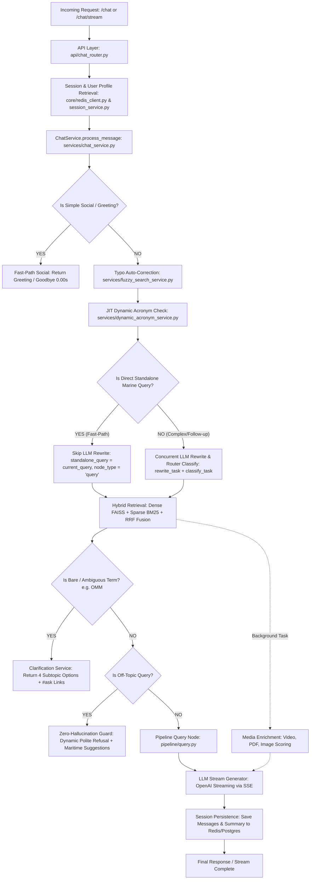

# Dolphin AI Backend — End-to-End Request Lifecycle & Execution Pipeline

> **Document Purpose:** Complete architectural and functional walkthrough of what happens when a user sends a chat request to the Dolphin AI backend. Details every file, function, validation rule, execution branch, and skip condition across the entire lifecycle.

---

## 1. High-Level Pipeline Architecture (Mermaid)

---

## 2. Directory & Component Mapping

| Layer / Stage | Primary File | Primary Class / Function | Responsibility |
|---|---|---|---|
| **API Entry** | `api/chat_router.py` | `chat()`, `chat_stream()` | Validates payload, manages session cookies/tokens, handles SSE streaming. |
| **Session & Cache** | `core/redis_client.py` | `RedisService` | Active session tracking, conversation history caching, rate limits, user memory. |
| **Pipeline Controller** | `services/chat_service.py` | `ChatService.process_message()` | Master orchestrator of the entire lifecycle. |
| **Query Screening** | `services/query_analyzer.py` | `is_simple_social_intent()`, `is_greeting_query()` | Instant regex matching for social, greetings, and short answers. |
| **Typo Repair** | `services/fuzzy_search_service.py` | `correct_query_typos()`, `detect_misspelled_query()` | Damerau-Levenshtein distance matching against 21,800 database topics. |
| **Acronym Resolution** | `services/dynamic_acronym_service.py` | `resolve_acronym()`, `harvest_course_acronyms()` | Auto-detects and expands 2–8 letter maritime acronyms in real time via LLM + cache. |
| **Acronym Registry** | `services/maritime_acronyms.py` | `is_known_maritime_acronym()`, `MARITIME_ACRONYMS_MAP` | 100+ standard maritime codes (SOLAS, MARPOL, STCW, EGCS, etc.). |
| **Query Rewrite & Routing** | `services/query_rewriter.py`, `services/query_analyzer.py` | `rewrite()`, `classify_for_router()` | Resolves coreferences (it/that) and classifies intent into QUERY, OFF_TOPIC, SOCIAL. |
| **Dense Vector Index** | `retrieval/faiss_store.py` | `FAISSStore.search()` | Exact L2 similarity search over 661 MB FAISS vector embeddings (`EMBEDDING_DIM=1536`). |
| **Sparse Keyword Search**| `retrieval/bm25_store.py` | `BM25OkapiStore.search()` | Exact lexical search over inverted index for technical codes and names. |
| **Rank Fusion** | `services/chat_service.py` | `VectorStoreAdapter.search_with_embeddings()` | Reciprocal Rank Fusion (RRF) combining FAISS and BM25 scores. |
| **Ambiguity Disambiguation** | `services/clarification_service.py`| `ClarificationService.check_and_build()` | Builds interactive subtopic options for broad/ambiguous terms (e.g., `OMM`, `PUMPS`). |
| **Off-Topic Guard** | `services/off_topic_detector.py` | `is_off_topic_query()`, `is_marine_domain_query()` | Strict domain guard preventing non-maritime hallucination. |
| **Media Enrichment** | `services/image_service.py`, `services/pdf_service.py`, `services/video_transcribe_service.py` | `_run_media_enrichment_task()` | Asynchronously attaches diagrams, PDF handbook pages, and video clips. |
| **Response Generation** | `pipeline/query.py` | `query_node()` | Constructs maritime system prompt, chunks context, and streams final answer. |

---

## 3. Phase-by-Phase Execution Details

### Phase 1: Request Ingestion & Validation
* **File:** `api/chat_router.py`
* **Function:** `chat_stream(request, payload, pool, ...)`
* **Validations:**
  1. `payload.content` or `payload.message`: Ensures non-empty string; raises `HTTPException(400)` if blank.
  2. Message length: Truncated/checked against `MAX_MESSAGE_LENGTH = 4000`.
  3. `session_id`: Fetched from Redis (`get_active_session`). If missing, creates a new session in PostgreSQL (`session_service.create_session`).
  4. User Profile: Loads user role, vessel name, vessel type, and company ID from Redis or DB.

---

### Phase 2: Intent Screening & Social Fast-Path
* **File:** `services/chat_service.py` (Lines 2660–2760)
* **Functions:** `is_simple_social_intent()`, `is_greeting_query()`
* **Validation & Matching:**
  * Checks if query is purely social: `GREETING` ("hi", "hello"), `GOODBYE` ("bye", "see you"), `THANK` ("thanks"), or `WELL_WISH` ("good morning").
* **Fast-Path Exit (Skip Condition):**
  * If matched: **SKIPS** LLM Query Rewrite, **SKIPS** FAISS retrieval, **SKIPS** BM25.
  * Router decision set instantly: `latencies["query_rewrite"] = 0.00s`.
  * Returns friendly greeting/goodbye in `< 50ms`.

---

### Phase 3: Typo Auto-Correction & Acronym Resolution
* **Files:** `services/fuzzy_search_service.py`, `services/dynamic_acronym_service.py`
* **Step A: Typo Check:**
  * `correct_query_typos(current_query, all_topic_names)`
  * Computes Damerau-Levenshtein distance against 21,800 database topics.
  * If a typo with distance $\le$ threshold is found (e.g., `balast` $\to$ `Ballast`), it seamlessly updates `current_query`.
* **Step B: JIT Acronym Discovery:**
  * Extracts uppercase tokens (2–8 letters).
  * If an unknown abbreviation appears, calls `dynamic_acronym_service.resolve_acronym(token)`.
  * Asks `gpt-4o-mini` once: *"Is this an IMO/maritime abbreviation?"*. Caches result in Redis for 30 days.

---

### Phase 4: Standalone Fast-Path vs. Concurrent LLM Rewrite
* **File:** `services/chat_service.py` (Lines 2705–2865)
* **Check: Is Direct Standalone Marine Query?**
  * Conditions:
    1. Not a social intent or greeting.
    2. Not a quiz or summary request (`is_quiz_or_summary == False`).
    3. Contains no pronouns / coreferences (`it`, `this`, `that`, `these`, `step 2`, `former`, `latter`).
    4. Not a follow-up starter (`and `, `why `, `what about `, `how come`).
    5. Length $\le$ 15 words.
    6. Contains a confirmed technical term (`is_tech_term`) or strong maritime signal (`_has_strong_signal`).
* **Branching:**
  * **If TRUE (Fast-Path):**
    * `standalone_query = current_query`
    * `node_type = "query"`, `user_category = "QUERY"`
    * `latencies["query_rewrite"] = 0.00s` (Saves 1.5–2.0 seconds of LLM latency!).
  * **If FALSE (Complex / Multi-turn):**
    * Spawns parallel tasks:
      * `rewrite_task = self.query_rewriter.rewrite(current_query, history)`
      * `classify_task = self.analyzer.classify_for_router(current_query, history)`
    * Merges results via `asyncio.gather()`.

---

### Phase 5: Hybrid Retrieval Engine (Dense + Sparse + RRF)
* **File:** `services/chat_service.py` & `retrieval/faiss_store.py` & `retrieval/bm25_store.py`
* **How It Executes:**
  1. **Dense Retrieval:** Generates 1536-dim vector via OpenAI `text-embedding-3-small`. Searches `faiss_index.bin` for top-$K$ nearest neighbors ($K=10$).
  2. **Sparse Retrieval:** Tokenizes query with maritime stemmer. Searches `faiss_index.bm25.pkl` for exact keyword matches.
  3. **Reciprocal Rank Fusion (RRF):**
     $$\text{RRF Score}(d) = \sum_{m \in \{\text{FAISS}, \text{BM25}\}} \frac{1}{60 + \text{rank}_m(d)}$$
  4. Merges metadata sidecar (`faiss_index.meta.json`) to return the highest-ranked `course_content` chunks.

---

### Phase 6: Clarification & Ambiguity Detection
* **File:** `services/clarification_service.py`
* **Trigger Conditions:**
  * User submits a bare or ambiguous term (e.g., `OMM`, `SOLAS`, `PUMPS`, `SCAVENGING`).
  * 2 or more distinct subtopics exist in the curriculum or international standards.
  * `skip_clarification == False` (user did not already click a specific clarification chip).
* **Execution:**
  * **SKIPS** regular direct generation.
  * Generates 3–4 distinct subtopic options with clickable links (`#ask:<query>`).
  * Formats response:
    > *"Which specific area would you like to explore?*  
    > *1. Emission Compliance (EGC units)*  
    > *2. System Guidelines*  
    > *3. Operational Safety"*

---

### Phase 7: Parallel Media Enrichment
* **Files:** `services/image_service.py`, `services/pdf_service.py`, `services/video_transcribe_service.py`
* **Execution:** Runs as an `asyncio.Task` in the background **concurrently** with the LLM response streaming.
  1. Inspects top retrieved chunks for linked `topic_video`, `topic_pdf`, or diagrams.
  2. Scores media relevance against query keywords.
  3. Appends video timestamps and PDF page references to the client event stream.

---

### Phase 8: Response Generation & Domain Guardrails
* **File:** `pipeline/query.py` & `services/off_topic_detector.py`
* **Execution:**
  1. **Zero-Hallucination Guard:** Calls `is_off_topic_query(standalone_query)`. If user asked about non-maritime topics (sports, cooking, politics, generic programming), rejects immediately with polite redirection + 3 dynamic maritime suggestion chips.
  2. **Context Assembly:** Prepares prompt with system directives:
     * Adhere strictly to IMO, SOLAS, MARPOL, STCW conventions.
     * Incorporate vessel profile (e.g., Tanker vs Bulk Carrier specifics).
     * Cite retrieved chunk content without hallucination.
  3. **Streaming:** Streams tokens live via SSE (`status_callback` and `stream_callback`).

---

### Phase 9: Session Persistence & Memory
* **Files:** `core/redis_client.py`, `services/session_service.py`
* **Execution:**
  1. Stores assistant response tokens in Redis list (`session_messages:{session_id}`).
  2. Updates running conversation summary if message count exceeds threshold.
  3. Flushes conversation records asynchronously to PostgreSQL `messages` table.

---

## 4. Scenario Walkthroughs: What Runs & What Skips

| Scenario | Input Query | Fast-Path? | Typo Check? | Clarification? | FAISS / BM25? | Final Output Type |
|---|---|---|---|---|---|---|
| **A. Simple Greeting** | `"Hello good morning"` | ✅ **YES** (Instant) | ⏭️ Skipped | ⏭️ Skipped | ⏭️ Skipped | Instant Social Greeting (0.02s) |
| **B. Bare Ambiguous Term** | `"OMM"` | ❌ No | ⏭️ Skipped (Acronym) | ✅ **Triggered** | ✅ Evaluated | Clarification Subtopic Menu |
| **C. Specific Question** | `"How does OMM ensure emission compliance?"` | ✅ **YES** (Direct Marine) | ⏭️ Skipped (Acronym) | ⏭️ Skipped (Specific) | ✅ Full Search | Full Maritime Answer + Media |
| **D. Pronoun Follow-Up** | `"How often must it be inspected?"` | ❌ No (Has *"it"*) | ⏭️ Skipped | ⏭️ Skipped | ✅ After Rewrite | LLM rewrites to *"How often must OMM be inspected?"* $\to$ Answers |
| **E. Misspelled Term** | `"tell me about balast water"` | ❌ No | ✅ **Corrects** (`balast` $\to$ `Ballast`) | ⏭️ Skipped | ✅ Full Search | Answers for Ballast Water |
| **F. Non-Maritime Query** | `"Who won the football world cup?"` | ❌ No | ⏭️ Skipped | ⏭️ Skipped | ⏭️ Blocked | Polite Refusal + Maritime Topic Suggestions |

---

## 5. Maintenance Guidelines

1. **Adding New Maritime Acronyms:** Register in `services/maritime_acronyms.py` (`MARITIME_ACRONYMS_MAP`) or let `DynamicAcronymService` harvest them automatically.
2. **Short Word Safeguard:** Never enable 1-letter typo distance on $\le 3$-letter words, or acronyms will falsely match 4-letter vocabulary words.
3. **Preserving Fast-Paths:** Ensure regex filters in `services/query_analyzer.py` stay lightweight to maintain sub-50ms fast-path responses.
